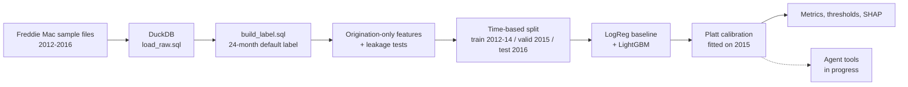
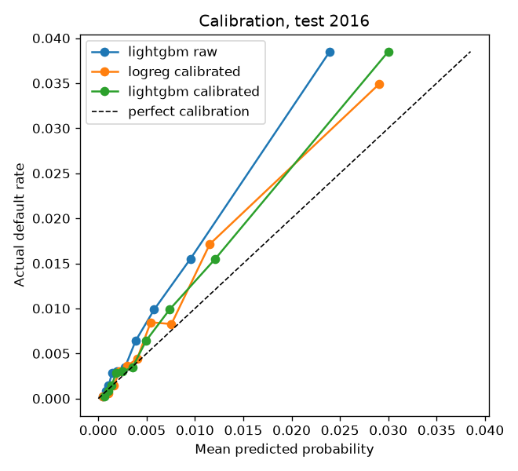
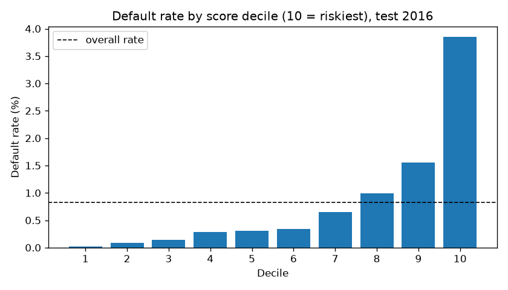
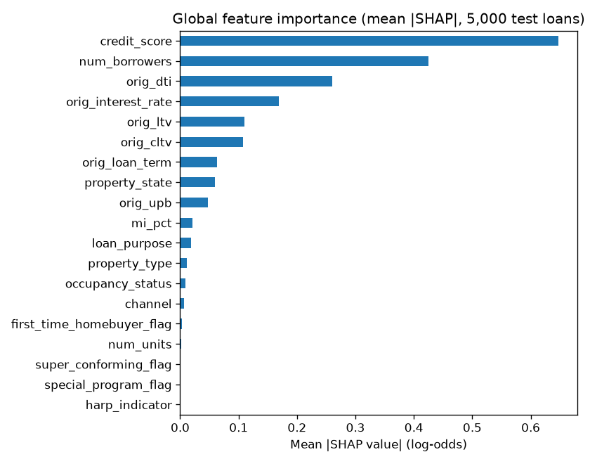

# credit-risk-agent

A mortgage default model built on Freddie Mac loan-level data, with a 24-month default label, a time-based holdout, and calibrated probabilities. A LangGraph agent that answers portfolio questions through validated SQL and model-scoring tools is **in progress** (see [Status](#status)).

> **Portfolio project on public data.** Not used for real credit decisions, and not work done at a job.

## Status

| Part | State |
|---|---|
| Data prep + 24-month default label (DuckDB SQL) | Done |
| Leakage controls + time-based split | Done |
| Logistic regression baseline + LightGBM (MLflow tracked) | Done |
| Evaluation, Platt calibration, cost-based thresholds, SHAP | Done |
| Model card | Done ([MODEL_CARD.md](MODEL_CARD.md)) |
| Agent tools + SQL guard | In progress |
| LangGraph agent, eval harness, CI regression gate | Not started |
| Streamlit demo | Not started |

## Architecture (current)



## Data

- **Source:** Freddie Mac Single-Family Loan-Level Dataset, sample files (Release 47 layout), origination years 2012–2016, 50,000 loans per year, performance through March 2026.
- **Not included in this repo.** The data requires registration with Freddie Mac, and no raw or loan-level data is committed. To reproduce, register, download the sample files, and place them where `scripts/prepare_data.py` expects them.
- **Why 2012–2016:** these vintages avoid the 2006–2008 crisis era, which behaves very differently. Every loan's 24-month window also ends before 2020, so COVID forbearance doesn't affect the label. Two caveats remain: HARP refinances make up 35.3% of 2012 loans but only 5.1% of 2016 loans, and 215 of the 407 test-year defaults are disaster-flagged.

## Label

`default_24m = 1` if, within loan ages 0–24, a loan reaches 90+ days delinquent, enters an RA (REO acquisition) status, or terminates with zero-balance code 02, 03, or 09 (credit events). `default_24m = 0` if the loan prepaid with no prior 90+ delinquency, or stayed active through month 24.

| | Count |
|---|---|
| Loans loaded | 250,000 |
| Monthly performance rows | 18,949,325 |
| Labeled loans | 246,040 |
| Defaults | 1,821 (0.74%) |
| Excluded | 3,960 (3,495 with no observation window, 464 other terminations, 1 right-censored) |

## Time-based split

| Split | Vintages | Loans | Defaults | Default rate |
|---|---|---|---|---|
| Train | 2012–2014 | 147,840 | 1,068 | 0.72% |
| Validation | 2015 | 48,600 | 346 | 0.71% |
| Test | 2016 | 49,600 | 407 | 0.82% |

There's no random shuffling across time. Tuning, calibration, and threshold choice all use 2015 only. The 2016 test set was used once, for final reporting.

## Results (2016 test vintage)

| Model | ROC-AUC | PR-AUC | KS | Brier |
|---|---|---|---|---|
| Logistic regression (C=0.1) | 0.8008 | 0.0322 | 0.4580 | TBD |
| LightGBM (lr 0.05, 15 leaves, 91 trees) + Platt | **0.8117** | **0.0340** | **0.4858** | 0.0080 |

- **LightGBM vs baseline:** the ROC-AUC difference is 0.0109, with a paired bootstrap 95% CI of [0.0011, 0.0213]. LightGBM came out ahead in 98.6% of bootstrap resamples.
- **Ranking:** the top score decile has a 3.85% default rate (4.69x lift) and contains 46.9% of all test defaults.
- **Calibration:** the mean calibrated probability is 0.65%, against an actual test default rate of 0.82%, so the model under-predicts the 2016 level. That's expected, because calibration was fitted on 2015 and 2016 had more defaults.
- **Disaster-flagged loans:** after excluding them (49,276 loans, 192 defaults), LightGBM ROC-AUC is 0.8298 and KS is 0.5191.
- PR-AUC is low in absolute terms because defaults are rare (0.82%). Its baseline is the default rate, not 0.5.

  <!-- check filename -->
  <!-- check filename -->

## Decision threshold (ASSUMED cost ratios)

The threshold minimizes expected cost, where a missed default costs *R* times a wrongly declined good loan. **R is an assumption for this demo, not a measured business number.** Each threshold was chosen on 2015 and evaluated on 2016.

| Assumed ratio R | Threshold | Test cost per 1,000 loans | Approve-all cost |
|---|---|---|---|
| 10 | TBD | worse than approve-all | TBD |
| 20 (primary) | 0.0493 | 163.21 | 164.11 |
| 40 | 0.0185 | 274.11 | 328.23 |

At R=20, the model only roughly breaks even with approving every loan. It adds clear value only when missed defaults are assumed to be much more costly (R=40).

## Explainability (SHAP)



The top features by mean |SHAP| (log-odds) are `credit_score` 0.648, `num_borrowers` 0.425, `orig_dti` 0.261, and `orig_interest_rate` 0.169. `harp_indicator` gets 0, but that doesn't mean HARP is irrelevant: every HARP loan has a missing DTI, so the model picks up HARP through `orig_dti` instead. SHAP explains the model, not causes in the world.

## Design decisions

- **90+ days delinquent within 24 months:** a common industry-style serious-delinquency definition, with a fixed window so every loan gets the same amount of time to default.
- **Censored loans excluded:** a loan that is still active with fewer than 24 months observed has an unknown outcome. Labeling it 0 would bias the default rate down.
- **Time-based split:** a lender scores future loans with a model trained on past ones. A random split would mix vintages and overstate performance.
- **Origination-only features:** nothing from the performance file except the label, enforced by `tests/test_leakage.py`. ZIP code is dropped.
- **Calibration:** threshold and cost decisions need probabilities that mean what they say, not just a good ranking.
- **Interest rate caveat:** the original rate already reflects the lender's risk pricing, so part of its signal is the lender's own risk assessment.

## Quickstart

```powershell
python -m venv .venv
.\.venv\Scripts\Activate.ps1
pip install -r requirements.txt

python scripts/prepare_data.py     # load raw files, build label -> data/credit.duckdb
python -m risk.train               # baseline + LightGBM, logged to MLflow
python -m risk.evaluate            # test metrics + plots -> reports/
python -m risk.threshold           # cost-based thresholds -> reports/s8_threshold.json
python -m risk.explain             # SHAP -> reports/
pytest                             # 81 tests
```

## Repo structure (current)

```
sql/            load_raw.sql, build_label.sql
scripts/        prepare_data.py
risk/           features, split, transforms, train, calibration, evaluate, threshold, explain
agent/          sql_guard.py (in progress)
notebooks/      01_eda.ipynb
tests/          label, leakage, split, train, evaluate, threshold, explain, sql_guard
reports/        metrics, plots, threshold config
MODEL_CARD.md
```

## Limitations

- The data contains only loans Freddie Mac purchased, so it isn't representative of all mortgages (selection bias).
- There's a single data source and five vintages. Macro conditions differ by vintage, and 2016 includes disaster-affected loans.
- Calibrated probabilities under-predict the 2016 default level (0.65% vs 0.82%).
- The cost ratios are assumptions, and at the primary ratio the model roughly breaks even with approve-all.
- This is a portfolio demo, not a credit decision system.