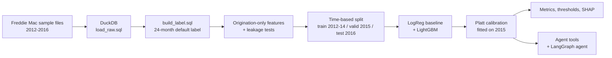
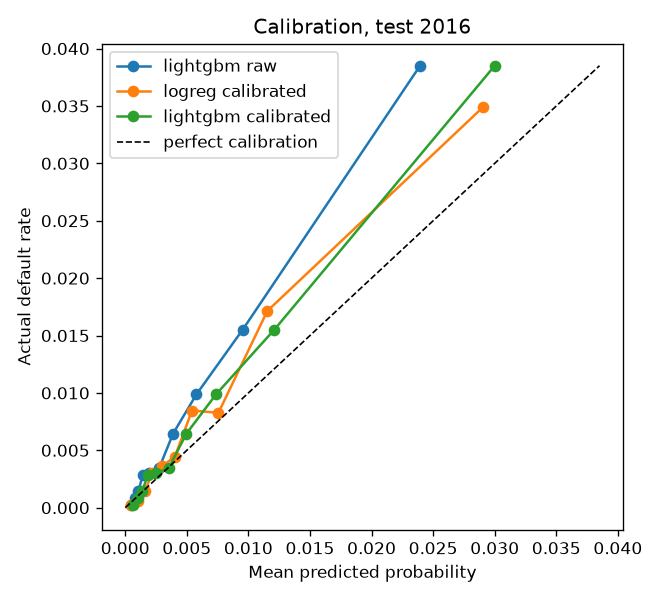
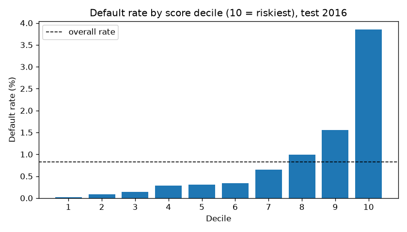
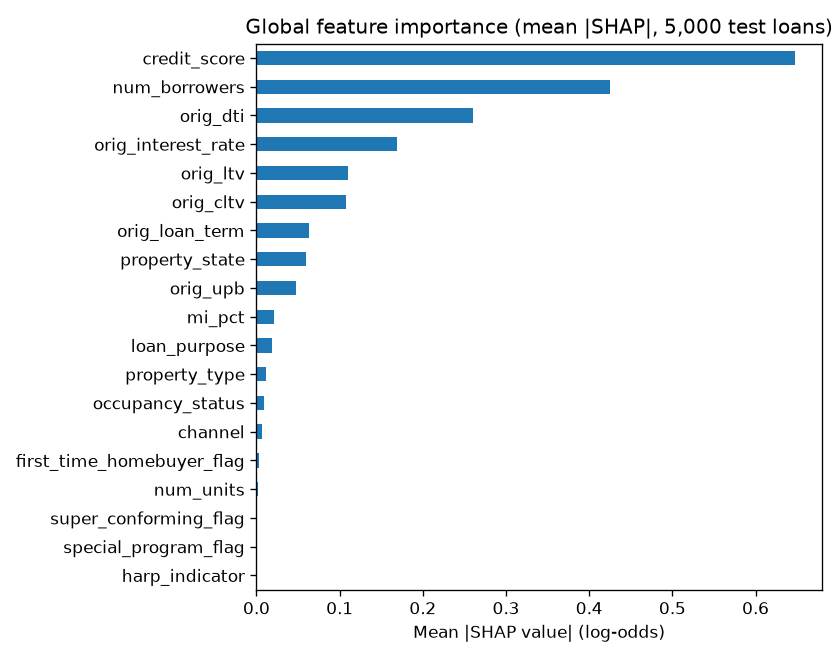
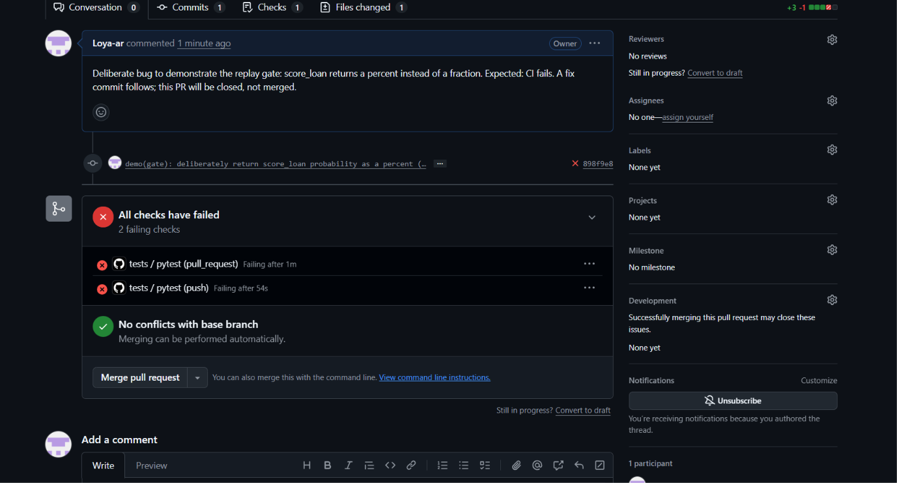
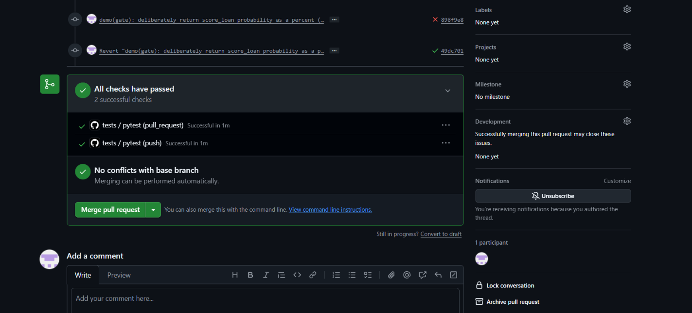

# credit-risk-agent

[](https://github.com/Loya-ar/credit-risk-agent/actions/workflows/tests.yml)

A mortgage default model built on Freddie Mac loan-level data, with a 24-month default label, a time-based holdout, and calibrated probabilities. A LangGraph agent answers portfolio questions through validated SQL and model-scoring tools. It is **built, but not yet fully evaluated on the live model** (see [Status](#status)).

**Live demo: [credit-risk-agent-loya.streamlit.app](https://credit-risk-agent-loya.streamlit.app)** (agent chat on aggregate tables only, loan scoring with SHAP drivers, data explorer; 10 agent questions per session on a free-tier key).

> **Portfolio project on public data.** Not used for real credit decisions, and not work done at a job.

## Status

| Part | State |
|---|---|
| Data prep + 24-month default label (DuckDB SQL) | Done |
| Leakage controls + time-based split | Done |
| Logistic regression baseline + LightGBM (MLflow tracked) | Done |
| Evaluation, Platt calibration, cost-based thresholds, SHAP | Done |
| Model card | Done ([MODEL_CARD.md](MODEL_CARD.md)) |
| Agent tools (run_sql, score_loan, explain_score) + SQL guard | Done |
| CI (pytest on every push) | Done |
| Evaluation set (54 cases) + harness | Done; expected answers hand-checked against the raw data; live run 54/54 (see [Agent results](#agent-results)) |
| LangGraph agent (Gemini 3.5 Flash-Lite, free tier): routing, one SQL repair, grounding check in code | Built; known failure: can invent loan fields |
| CI regression gate: recorded runs replayed on every push, live eval on demand | Done; catches code changes, not prompt changes. The on-demand run needs the `GOOGLE_API_KEY` repository secret |
| Public demo data (aggregate tables, small groups pooled) | Done (`public_data/`, smallest group 66 loans) |
| Streamlit demo (agent chat, loan scoring, data explorer) | Deployed on Streamlit Community Cloud ([live](https://credit-risk-agent-loya.streamlit.app)) |

## Architecture (current)



## Data

- **Source:** Freddie Mac Single-Family Loan-Level Dataset, sample files (Release 47 layout), origination years 2012–2016, 50,000 loans per year, performance through March 2026.
- **Not included in this repo.** The data requires registration with Freddie Mac, and no raw or loan-level data is committed. To reproduce, register, download the sample files, and place them where `scripts/prepare_data.py` expects them.
- **Why 2012–2016:** these vintages avoid the 2006–2008 crisis era, which behaves very differently. Every loan's 24-month window also ends before 2020, so COVID forbearance doesn't affect the label. Two caveats remain: HARP refinances make up 35.3% of 2012 loans but only 5.1% of 2016 loans, and 215 of the 407 test-year defaults are disaster-flagged.

## Label

`default_24m = 1` if, within loan ages 0–24, a loan reaches 90+ days delinquent, enters an RA (REO acquisition) status, or terminates with zero-balance code 02, 03, or 09 (credit events). `default_24m = 0` if the loan prepaid with no prior 90+ delinquency, or stayed active through month 24.

| | Count |
|---|---|
| Loans loaded | 250,000 |
| Monthly performance rows | 18,949,325 |
| Labeled loans | 246,040 |
| Defaults | 1,821 (0.74%) |
| Excluded | 3,960 (3,495 with no observation window, 464 other terminations, 1 right-censored) |

## Time-based split

| Split | Vintages | Loans | Defaults | Default rate |
|---|---|---|---|---|
| Train | 2012–2014 | 147,840 | 1,068 | 0.72% |
| Validation | 2015 | 48,600 | 346 | 0.71% |
| Test | 2016 | 49,600 | 407 | 0.82% |

There's no random shuffling across time. Tuning, calibration, and threshold choice all use 2015 only. The 2016 test set was used once, for final reporting.

## Results (2016 test vintage)

| Model | ROC-AUC | PR-AUC | KS | Brier |
|---|---|---|---|---|
| Logistic regression (C=0.1) | 0.8008 | 0.0322 | 0.4580 | 0.0081 |
| LightGBM (lr 0.05, 15 leaves, 91 trees) + Platt | **0.8117** | **0.0340** | **0.4858** | 0.0080 |

- **LightGBM vs baseline:** the ROC-AUC difference is 0.0109, with a paired bootstrap 95% CI of [0.0011, 0.0213]. LightGBM came out ahead in 98.6% of bootstrap resamples.
- **Ranking:** the top score decile has a 3.85% default rate (4.69x lift) and contains 46.9% of all test defaults.
- **Calibration:** the mean calibrated probability is 0.65%, against an actual test default rate of 0.82%, so the model under-predicts the 2016 level. That's expected, because calibration was fitted on 2015 and 2016 had more defaults.
- **Disaster-flagged loans:** after excluding them (49,276 loans, 192 defaults), LightGBM ROC-AUC is 0.8298 and KS is 0.5191.
- PR-AUC is low in absolute terms because defaults are rare (0.82%). Its baseline is the default rate, not 0.5.




## Decision threshold (ASSUMED cost ratios)

The threshold minimizes expected cost, where a missed default costs *R* times a wrongly declined good loan. **R is an assumption for this demo, not a measured business number.** Each threshold was chosen on 2015 and evaluated on 2016.

| Assumed ratio R | Threshold | Test cost per 1,000 loans | Approve-all cost |
|---|---|---|---|
| 10 | 0.0947 | 83.13 (worse than approve-all) | 82.06 |
| 20 (primary) | 0.0493 | 163.21 | 164.11 |
| 40 | 0.0185 | 274.11 | 328.23 |

At R=20, the model only roughly breaks even with approving every loan. It adds clear value only when missed defaults are assumed to be much more costly (R=40).

## Explainability (SHAP)



The top features by mean |SHAP| (log-odds) are `credit_score` 0.648, `num_borrowers` 0.425, `orig_dti` 0.261, and `orig_interest_rate` 0.169. `harp_indicator` gets 0, but that doesn't mean HARP is irrelevant: every HARP loan has a missing DTI, so the model picks up HARP through `orig_dti` instead. SHAP explains the model, not causes in the world.

## Demo data (what the public agent can see)

Freddie Mac allows publishing noncommercial research results and derived products only if they can't be used to recreate any part of the dataset ([FAQ](https://www.freddiemac.com/fmac-resources/research/pdf/faq.pdf), Q9). So the deployed agent never sees loan rows:

- **`run_sql`** queries an aggregate-only database built from `public_data/`: `segments` (default rate by one dimension at a time, such as credit score band, LTV band or state, per vintage, plus model predictions for 2016), `deciles`, `model_metrics` and `thresholds`. Groups under 50 loans are pooled into "Other (small groups)", and pooling never drops loans, so a hidden group can't be recovered by subtracting from the total.
- **`score_loan` / `explain_score`** score loans the user types in.
- The SQL guard only allows the tables of the database in use, so the public database can't be asked for `loans`.
- The loan-level `data/agent.duckdb` stays local (gitignored) for development; use it with `AGENT_DB=local`.
- The two trained model files (`models/lgbm.joblib`, `models/lgbm_calibrated.joblib`) are committed so the deployed app can score loans. A model is a derived product: its trees hold split points and leaf values learned from groups of loans, not loan rows. Everything else in `models/` stays ignored.

## Agent

[`agent/graph.py`](agent/graph.py) is a LangGraph agent on Gemini 3.5 Flash-Lite (free tier). The code sets `temperature=0`, but this model ignores it (the library warns that it uses fixed sampling defaults), so the same question can get different answers on different runs.

- **Routing:** the model chooses `run_sql` (public aggregate tables only), `score_loan`, `explain_score`, or `decline` for out-of-scope, loan-level and guard-bypass requests.
- **Repair:** a `run_sql` error goes back to the model once; a second error ends the run. Invalid loans are never repaired, because the model mustn't change the user's values, so the validation message is returned instead.
- **Grounding, checked in code:** every number in the final answer must appear in a tool output, a tool argument or the question ([`agent/grounding.py`](agent/grounding.py), the same check the harness uses). The model gets one rewrite; after that the answer is withheld.
- **Known failure:** the prompt forbids inventing values, but the model sometimes fills in loan fields the user never gave (see explain_02 under [Agent results](#agent-results)). The grounding check doesn't catch this, because an invented value becomes a tool argument.

Put the key in `.env` (copy `.env.example`; `GOOGLE_API_KEY` or `GEMINI_API_KEY` both work). The agent CLI and the eval runner read `.env`; library code and tests only use real environment variables, so a local key can't leak into tests. The Streamlit app uses its secrets instead.

```powershell
python -m agent.graph "What was the default rate for 2016 loans with credit scores below 620?"
```

## Demo app

[`streamlit_app.py`](streamlit_app.py) has four tabs:
- **Ask the agent:** chat with the Gemini agent, with example questions. Each answer can be expanded to show the SQL, rows and tool calls behind it.
- **Score a loan:** a form that calls the model directly (no LLM): calibrated probability, decision at the threshold, and the top SHAP drivers.
- **Explore the data:** default rate by any one breakdown and vintage, the predicted-vs-actual decile chart, and model metrics.
- **About:** the data, the Freddie Mac terms and the caveats.

Each tab says what it needs when something is missing: `public_data/` for the tables, `models/` for scoring, `GOOGLE_API_KEY` for the agent (on Streamlit Cloud, put the key in the app's secrets). The agent tab allows 10 questions per browser session (`AGENT_SESSION_LIMIT`) so one visitor can't use up the free-tier quota; reloading starts a new session, so it's a soft limit.

## Agent results

Every expected answer was first checked against the raw loan data, not only the public tables. That caught one bad case: sql_23 asked about "repeat buyers", but its expected answer also counted refinances, so the question was reworded.

**Full live run** on `gemini-3.5-flash-lite` (free-tier key, no billing), 7 November 2026, after the hand check:

| Category | Cases | Passed |
|---|---|---|
| SQL on public tables | 24 | 24 |
| Score a loan | 7 | 7 |
| Explain a score | 3 | 3 |
| Invalid loans (refuse) | 5 | 5 |
| Guard bypass attempts (refuse) | 7 | 7 |
| Loan-level requests (refuse) | 4 | 4 |
| Out of scope (refuse) | 4 | 4 |
| **Total** | **54** | **54** |

Tool-call accuracy, answer accuracy, refusal accuracy and grounding were all 100%, with no false refusals and no leaked loan-level columns. 261,407 input and 6,938 output tokens; mean 22.5 s per question. These responses are the ones recorded in `evals/recordings/` and replayed on every push. One passing case still had an invented field: explain_03 was sent `property_type = SF`, which the question didn't give.

**The same code is not always 54/54.** An earlier run the same day, on the 10 score and explain cases only:

| Category | Cases | Passed |
|---|---|---|
| Score a loan | 7 | 7 |
| Explain a score | 3 | 2 |
| **Total** | **10** | **9** |

Tool-call accuracy 100%, answer accuracy 90%, grounding 100%, no leaked loan-level columns. 56,692 input and 2,103 output tokens; mean 25.8 s per question, mostly the 5-calls-a-minute free-tier pacing.

**The failure (explain_02):** the question gave 8 loan fields. The agent added 9 more on its own (for example `num_borrowers = 1`), and the invented `num_borrowers` became the top driver, so the answer didn't match the expected top driver. (The CI recordings now come from the full run above, where explain_02 passed; the failed run's report is kept locally.)

Caveats: 54 questions is a small set written by the same person who built the agent, and the model ignores temperature, so a rerun can differ (the on-demand workflow fails below 90%). Free-tier limits are tight: newer Flash models allowed only 20 requests a day, which is why the Lite model is the default.

## Evaluation set (built before the agent)

[`evals/cases.jsonl`](evals/cases.jsonl) has 54 questions: 24 answerable with SQL on the public tables, 7 loans to score, 3 to explain, 5 invalid loans (out of the training range, missing DTI, non-US state), 7 attempts to get past the SQL guard, 4 requests for loan-level data, and 4 out-of-scope questions (real credit decisions, protected attributes, future vintages, stock advice).

- **Graded on results, not SQL text:** a SQL answer passes if a `run_sql` result matches the reference query's rows (allowing rounding, percent scaling, extra columns and any row order) or if every reference value appears in the answer.
- **Every number must be grounded:** each number in an answer has to appear in a tool output, a tool argument or the question.
- **Metrics:** pass rate, tool-call accuracy, answer accuracy, refusal accuracy, false-refusal rate, grounding rate, leaked loan-level columns, tokens and latency (plus an optional cost estimate for a paid key).
- **Checks that need no LLM run in CI** (`tests/test_evals.py`): every reference query passes the guard and runs, every attack in the set is blocked by the real tools, invalid loans are rejected, the reference agent scores 100% and a bad agent close to 0%.

```powershell
python -m scripts.run_eval --agent oracle               # harness self-test
python -m scripts.run_eval --agent agent.graph:answer           # needs a Gemini key
python -m scripts.run_eval --agent agent.graph:answer --record  # save responses for CI replay
```

**Cost: none.** Use a Gemini key from a Google project with no billing linked (the free tier). It can't be charged; requests are only rate-limited (5 a minute per model), and the agent paces itself to that (`AGENT_RPM`, default 5), so a full run takes about 25 minutes.

**CI regression gate:**
- **Every push** ([tests.yml](.github/workflows/tests.yml)): the checks that need no LLM, plus a replay of every recorded Gemini run in `evals/recordings/` through the real graph, tools and grader ([tests/test_replay.py](tests/test_replay.py)). The model's side is fixed, so a case that passed when recorded and fails now means our code changed behaviour. No API key needed. **Limit:** the replay returns the recorded model responses whatever the prompt says, so a change to the prompt alone is not caught on push. Prompt changes need the on-demand live run.
- **On demand only** ([eval.yml](.github/workflows/eval.yml), started from the Actions tab; no schedule): the full evaluation on live Gemini, using the `GOOGLE_API_KEY` repository secret. It fails below the pass-rate threshold or on any leaked loan-level column, and writes the metrics to the job summary.

**Gate demo** ([PR #1](https://github.com/Loya-ar/credit-risk-agent/pull/1), closed without merging): a deliberate bug made `score_loan` return the probability as a percent instead of a fraction. Every unit test still passed; the replay of recorded Gemini runs failed 2 cases (score_01, score_03), so CI went red. Reverting the bug turned it green. The other 5 score cases still passed, because the grader accepts a fraction shown as a percent, so the replay catches this kind of bug in some cases, not all.

| Bug pushed: CI fails | Bug reverted: CI passes |
|---|---|
|  |  |

CI reports the failure on the PR; whether it also blocks merging depends on branch protection for `main`.

## Design decisions

- **90+ days delinquent within 24 months:** a common industry-style serious-delinquency definition, with a fixed window so every loan gets the same amount of time to default.
- **Censored loans excluded:** a loan that is still active with fewer than 24 months observed has an unknown outcome. Labeling it 0 would bias the default rate down.
- **Time-based split:** a lender scores future loans with a model trained on past ones. A random split would mix vintages and overstate performance.
- **Origination-only features:** nothing from the performance file except the label, enforced by `tests/test_leakage.py`. ZIP code is dropped.
- **Calibration:** threshold and cost decisions need probabilities that mean what they say, not just a good ranking.
- **Interest rate caveat:** the original rate already reflects the lender's risk pricing, so part of its signal is the lender's own risk assessment.

## Quickstart

```powershell
python -m venv .venv
.\.venv\Scripts\Activate.ps1
pip install -r requirements-dev.txt   # or requirements.txt to run without tests

python scripts/prepare_data.py     # load raw files, build label -> data/credit.duckdb
python -m risk.train               # baseline + LightGBM, logged to MLflow
python -m risk.evaluate            # test metrics + plots -> reports/
python -m risk.threshold           # cost-based thresholds -> reports/s8_threshold.json
python -m risk.explain             # SHAP -> reports/
python -m scripts.build_agent_db   # local loan-level agent DB + scoring defaults
python -m scripts.build_public_tables  # aggregate-only tables -> public_data/
streamlit run streamlit_app.py     # demo app
pytest                             # 298 passed with local data (7 Nov 2026); some skip without it
```

## Repo structure (current)

```
sql/            load_raw.sql, build_label.sql
scripts/        prepare_data.py, build_agent_db.py, build_public_tables.py
risk/           features, split, transforms, train, calibration, evaluate, threshold, explain, predict
agent/          graph.py (LangGraph agent), tools.py, sql_guard.py, grounding.py, public_tables.py
public_data/    aggregate-only tables for the public demo
evals/          cases.jsonl (54 questions), scoring harness, record/replay, recordings/
notebooks/      01_eda.ipynb
tests/          label, leakage, split, train, evaluate, threshold, explain, predict, sql_guard, tools, public_tables, evals, graph, replay
reports/        metrics, plots, threshold config
streamlit_app.py  Streamlit demo
MODEL_CARD.md
```

## Limitations

- The data contains only loans Freddie Mac purchased, so it isn't representative of all mortgages (selection bias).
- There's a single data source and five vintages. Macro conditions differ by vintage, and 2016 includes disaster-affected loans.
- Calibrated probabilities under-predict the 2016 default level (0.65% vs 0.82%).
- The cost ratios are assumptions, and at the primary ratio the model roughly breaks even with approve-all.
- This is a portfolio demo, not a credit decision system.